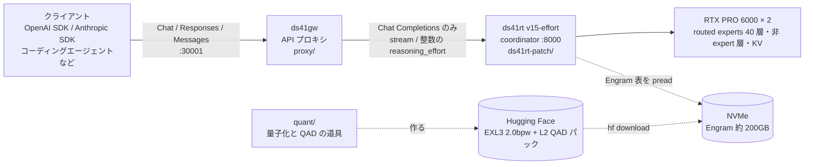

# deepseek-v41-flash-2gpu

DeepSeek-V4.1-Flash-1017 を、1 台のワークステーション (RTX PRO 6000 96GB × 2) で動かすための一式。
2bit の EXL3 量子化と局所 QAD で作った重みのパック、推論エンジン [ds41rt](https://github.com/tpurtell/ds41rt) への小さな改修、
OpenAI / Anthropic 互換の API プロキシ、量子化と QAD の道具、調査の記録をまとめてある。

[English summary](#english)

> **状態**: 個人の研究プロジェクト。動作を確かめたのは 1 台の機械 (下記) だけである。数値はすべてその機械での実測値。

## 到達点

測った機械: RTX PRO 6000 Blackwell Max-Q Workstation (96GB、300W) × 2、RAM 128GB、Engram 表は NVMe に置く。
重みは、routed experts を EXL3 2.0bpw にしたパック (下の「重み」)。エンジンは ds41rt v15 (Spark を使わない構成)。

| 項目 | 結果 |
|---|---|
| 重みの大きさ | 334GB (48 shard)。うち Engram 表が約 200GB で、NVMe から必要な行だけ読む。GPU に載るのは experts と非 expert の層 |
| 品質 (教師 = 1017 原重み、teacher-forced、top-32 上の KL) | エージェント要求 KL 0.158 (無校正 v0) → 0.059 (v1: Viterbi + scale refit) → **0.046** (v1-l2e: + L2 QAD)。top-1 一致 86.4% → 91.8% → **92.5%** |
| 日本語 | 日本語回答 KL 0.206 → 0.074 → **0.060**、日本語の文章 (Wikipedia・青空文庫など 32 本) KL 0.139 → **0.120** (v1 → l2e) |
| 中国語の混入 (中国語専用トークンの確率質量、教師比) | 日本語回答で 7.83 倍 (v0) → 2.20 倍 (v1) → **0.98 倍** (l2e) |
| 画像 | 245 問の正答率 87.9% (v1) → **88.0%** (l2e)。画像 KL 0.251 (v0) → 0.132 → **0.121** |
| 生成速度 (ds41rt、思考込み、T=0.6) | 1 本 **116 tok/s**、16 本同時で合計 **413 tok/s** |
| ds41rt 付属ベンチ (greedy、9 区分の加重) | **147.9 tok/s** (公表値 146.2 は 400W の 2x6000) |
| prefill | 4,300〜4,800 tok/s (8K〜67K トークン、v1 で測定) |
| vLLM (+ vllm-exl3) との比較 | 同じ重みで ds41rt が 16 本同時 +45%、prefill 2.3〜2.7 倍 |
| API | プロキシ ds41gw で Chat Completions・Responses・Anthropic Messages・legacy completions を出す。追加遅延は TTFT の中央値 +2.4 ms |

品質の評価セットの一部 (エージェント要求 24 本、日本語回答 16 本) は私的な要求ログから作ったので公開していない。
詳しい数値と条件は [docs/results/](docs/results/) にある。

## 構成



| ディレクトリ | 中身 |
|---|---|
| [`proxy/`](proxy/) | **ds41gw**: ds41rt の前に置く API 変換プロキシ (Rust)。ds41rt は Chat Completions しか出さないので、Responses と Anthropic Messages を変換し、クライアントごとの癖 (model 名、既定値、思考の指定、ツール履歴) を吸収する |
| [`ds41rt-patch/`](ds41rt-patch/) | ds41rt (upstream `3067d06` = v15) への改修。reasoning effort を整数 1〜100 で受ける。パッチ、改修した deepseek-recipe、1 台用の起動の差分と設定の雛形 |
| [`quant/`](quant/) | 量子化と QAD の道具。層ストリーミングの参照ハーネス、MoE の入出力の捕捉、L2 局所 QAD、評価 (KL・中国語混入・画像)、校正データの組み立て、ビルドの手順 |
| [`docs/`](docs/) | 調査の記録 (`research/`) と結果 (`results/`)。日本語 |

## 重み

Hugging Face: [`ChiTako/DeepSeek-V4.1-Flash-1017-EXL3-2.0bpw-QAD-ja`](https://huggingface.co/ChiTako/DeepSeek-V4.1-Flash-1017-EXL3-2.0bpw-QAD-ja)

- 元: `deepseek-ai/DeepSeek-V4.1-Flash` の 1017 版 (MIT)。
- routed experts (40 層 × 384 本 × 3 行列): EXL3 2.0bpw、K2 MCG コードブック。exllamav3 1.5.1 の Viterbi で再符号化し、scale (suh/svh) を閉形式で合わせ直した (v1)。
- そのうえで L2 局所 QAD: EXL3 の離散コードは固定し、各 expert の suh/svh だけを、教師 (原重み) の expert 出力に合わせて蒸留した。
  校正は 256K トークン (日本語 40%) と画像入り 24 系列、画像の重み 1.5、画像の誤差が悪化する expert は採らない (画像ガード)。採用 14,582 / 15,360 本。
- 非 expert の層 (attention、shared expert、embedding、lm_head、ViT) と Engram 表は公式 1017 と同じバイト列。

## クイックスタート

前提: Linux、NVIDIA ドライバと nvidia-container-toolkit、docker (手順では `sudo docker`)、SM120 の 96GB GPU 2 枚、RAM 128GB、NVMe に 340GB 以上の空き。

```sh
# 0. このリポジトリを取る (以下は ds41rt と同じ階層に置く前提)
git clone https://github.com/Chiytako/deepseek-v41-flash-2gpu

# 1. 重み (334GB) を HF キャッシュに落とす
hf download ChiTako/DeepSeek-V4.1-Flash-1017-EXL3-2.0bpw-QAD-ja

# 2. ds41rt に改修を当てて、派生イメージを作る (GPU 不要。初回は rustup と crates.io に接続する)
git clone https://github.com/tpurtell/ds41rt && cd ds41rt
git checkout 3067d06
cp -r ../deepseek-v41-flash-2gpu/ds41rt-patch/third_party/deepseek-recipe-patched third_party/
git am ../deepseek-v41-flash-2gpu/ds41rt-patch/patches/*.patch   # git の user.name / user.email が要る
cp run.sh run-local.sh && patch run-local.sh ../deepseek-v41-flash-2gpu/ds41rt-patch/run-local.sh.diff
sudo docker pull ghcr.io/tpurtell/ds41rt-coordinator:v15
scripts/build-effort-image.sh                      # -> ds41rt-coordinator:v15-effort

# 3. 設定を作って起動する (MODEL_ID は 1. の repo になっている。GPU の UUID などを必要に応じて直す)
cp ../deepseek-v41-flash-2gpu/ds41rt-patch/local.config.example local.config
$EDITOR local.config
./run-local.sh --config local.config                # :8000

# 4. プロキシ
cd ../deepseek-v41-flash-2gpu/proxy
DS41GW_TOKENIZER="$(hf download ChiTako/DeepSeek-V4.1-Flash-1017-EXL3-2.0bpw-QAD-ja tokenizer.json)" ./run_proxy.sh   # :30001 (hf download はキャッシュ内のパスを出す)

curl -s localhost:30001/v1/chat/completions -H 'content-type: application/json' \
  -d '{"model":"x","messages":[{"role":"user","content":"日本の首都は？"}],"reasoning_effort":"low","max_tokens":256}'
```

詳しくは [`ds41rt-patch/README.md`](ds41rt-patch/README.md) と [`proxy/README.md`](proxy/README.md)。

## reasoning effort の値 (独自の対応)

DeepSeek-V4.1 のプロンプトは `Reasoning Effort: N` (N は 1〜100) で思考の深さを受ける。この改修では、整数をそのまま渡せるようにし、段階名を次のように写す。

| 要求の値 | このリポジトリ | 公式 (deepseek-recipe 0.1.0) |
|---|---|---|
| `none` / `off` / `disabled` | 思考なし | 思考なし (`none`) |
| `minimal` / `low` | 50 | 50 |
| `medium` | **62** | 75 |
| `high` (未指定もこれ) | 75 | 75 |
| `xhigh` | **88** | 75 |
| `max` (`ultra`) | 100 | 100 |
| 整数 1〜100、数値文字列 | そのまま | 受けない |

**`medium`→62 と `xhigh`→88 は公式と違う、このリポジトリだけの対応である。**
公式の encoding が段階名で定めるのは low (50)・high (75)・max (100) の 3 つだけで、公式の deepseek-recipe は OpenAI / Anthropic の API の名前を受けるために `medium` と `xhigh` を high と同じ 75 に写す。
そのままでは `medium`・`high`・`xhigh` が同じプロンプトになるので、`medium` を low と high の間、`xhigh` を high と max の間に置いた。
公式どおりにしたいときは、プロキシの `thinking.effort_map` に `medium = 75, xhigh = 75` と書くか、整数で 75 を送る。

## 公開していないもの

- GLM-5.3-Flash 時代の要求ログと、そこから作ったデータ (校正の一部、評価セットの一部、再生用の要求集、教師の出力)。
  道具はそのまま入れてあるので、使うときは自分のデータを用意する (`quant/README.md`)。
- 再配布できない画像評価データ (DocVQA、ChartQA など)。取得の道具 (`quant/tools/vl/`) だけを入れてある。
- 実行時の状態とログ (`proxy/logs/`、`proxy/state/`)、試験の結果ファイル。

## ライセンス

MIT ([LICENSE](LICENSE))。第三者のコードとデータは [THIRD_PARTY_NOTICES.md](THIRD_PARTY_NOTICES.md) を参照。重みのライセンスは元の DeepSeek-V4.1-Flash (MIT) に従う。

---

## English

Everything needed to run **DeepSeek-V4.1-Flash-1017 on a single workstation with two RTX PRO 6000 (96 GB) GPUs**:
a 2-bit EXL3 weight pack refined with local QAD, a small patch to the [ds41rt](https://github.com/tpurtell/ds41rt) inference engine,
an OpenAI/Anthropic-compatible API proxy, the quantization/QAD tooling, and the research notes (in Japanese).

**Results** (2x RTX PRO 6000 Blackwell Max-Q 300 W, 128 GB RAM, Engram tables on NVMe; ds41rt v15 without Spark nodes):

| | |
|---|---|
| Pack | 334 GB in 48 shards; routed experts in EXL3 2.0 bpw (K2, MCG codebook); non-expert layers and Engram tables byte-identical to the official 1017 checkpoint |
| Quality vs. the 1017 original (teacher-forced KL over teacher top-32) | agent prompts 0.158 (uncalibrated) → 0.059 (Viterbi re-encode + scale refit) → **0.046** (+ L2 QAD); top-1 agreement 86.4% → 91.8% → **92.5%**; Japanese answers 0.206 → 0.074 → **0.060** |
| Chinese leakage into Japanese answers (Chinese-only token mass, relative to teacher) | 7.83× → 2.20× → **0.98×** |
| Vision | 245-question accuracy 87.9% → **88.0%** |
| Decode (thinking on, T=0.6) | **116 tok/s** single stream, **413 tok/s** aggregate at 16 concurrent |
| ds41rt release bench (greedy, weighted) | **147.9 tok/s** |
| vs. vLLM + vllm-exl3 on the same weights | +45% at 16 concurrent, 2.3–2.7× prefill |

**Layout**: `proxy/` (ds41gw, Rust: Chat Completions, Responses and Anthropic Messages on top of ds41rt's Chat-only API),
`ds41rt-patch/` (patches against upstream `3067d06`: numeric `reasoning_effort` 1–100, a derived `v15-effort` image, a single-host launcher diff and config template),
`quant/` (layer-streaming reference harness, MoE capture, L2 local QAD, KL / Chinese-leakage / vision evaluation, calibration builder, build scripts),
`docs/` (research notes and results).

**Reasoning effort**: level names map to none → no thinking, minimal/low → 50, **medium → 62**, high (default) → 75, **xhigh → 88**, max → 100; integers 1–100 pass through.
`medium = 62` and `xhigh = 88` are **this project's own choice**: the official encoding defines only low/high/max, and the official deepseek-recipe maps both medium and xhigh to 75.
Set `thinking.effort_map = { medium = 75, xhigh = 75 }` in the proxy to get the official behaviour.

**Not included**: the private request logs from an earlier deployment and every dataset derived from them (part of the calibration and evaluation sets),
image benchmarks that cannot be redistributed (DocVQA, ChartQA, ...), runtime logs and state. The tools are included; bring your own data.

**License**: MIT. See [THIRD_PARTY_NOTICES.md](THIRD_PARTY_NOTICES.md). The weights follow the original DeepSeek-V4.1-Flash license (MIT).
